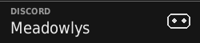
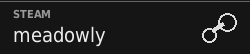
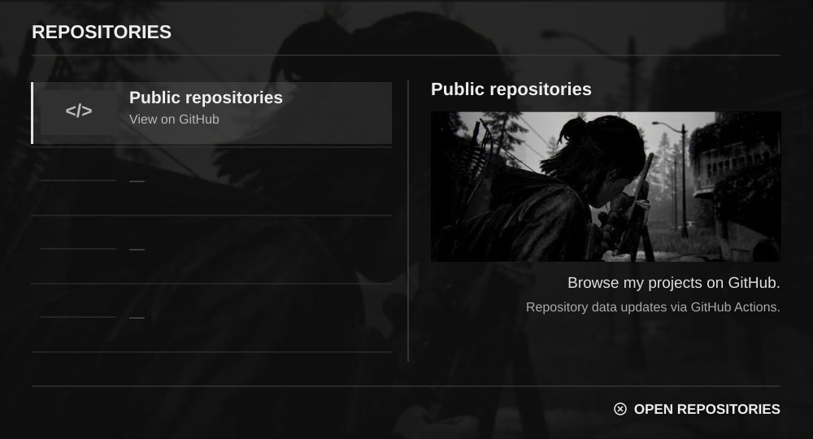
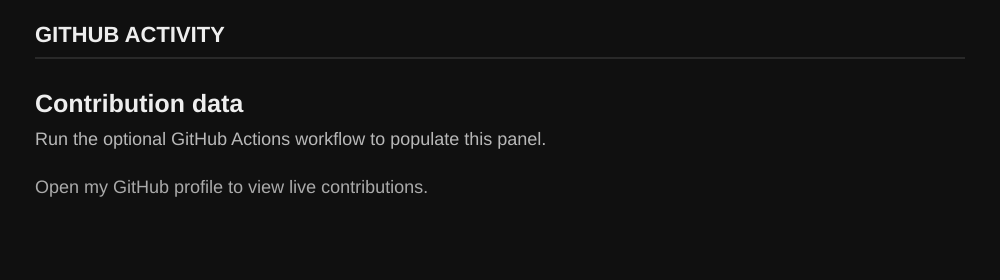
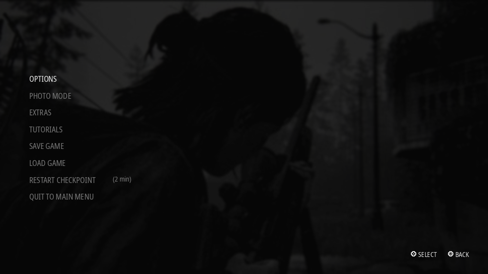

<!-- Layout inspiration: https://github.com/Glauedson. TLOU UI reference: https://interfaceingame.com/games/the-last-of-us-part-ii/ -->

  
  

<table>
<tr>
<td width="24%" align="center" valign="middle"></td>
<td width="76%" valign="middle">

### hey, i'm meadow

16, mostly into game dev and survival games. tlou is easily my favorite franchise, but i play dying light and minecraft too.

i mess around with unity, unreal, blender and code whenever i feel like making something ig.

`discord: Meadowlys` · [steam](https://steamcommunity.com/id/meadowly/) · [repos](https://github.com/meadowlys?tab=repositories)

</td>
</tr>
</table>

  
  
  

<a href="https://github.com/meadowlys?tab=repositories">all repos ↗</a>

<b>more github stats</b>

 

  
  
  

<b>extras</b>

 

<a href="https://interfaceingame.com/screenshots/the-last-of-us-part-ii-pause-menu/">original in-game screen</a>

