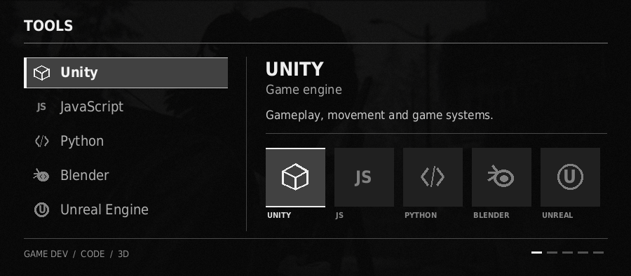
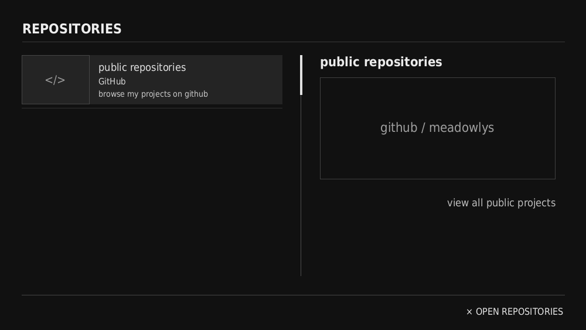

<table><tr><td width="24%" align="center"></td><td width="76%">

### hey, i'm meadow

16. mostly into game dev and survival games, tlou is easily my favorite franchise. i play dying light and minecraft too ig.

usually messing around with unity, unreal or blender and coding random stuff.

**discord:** `Meadowlys` &nbsp; / &nbsp; [steam](https://steamcommunity.com/id/meadowly/) &nbsp; / &nbsp; [github](https://github.com/meadowlys)

</td></tr></table>

---

<!-- PROJECTS:START -->

<a href="https://github.com/meadowlys?tab=repositories">all repositories</a>

<!-- PROJECTS:END -->

---

 

extras
 

  

